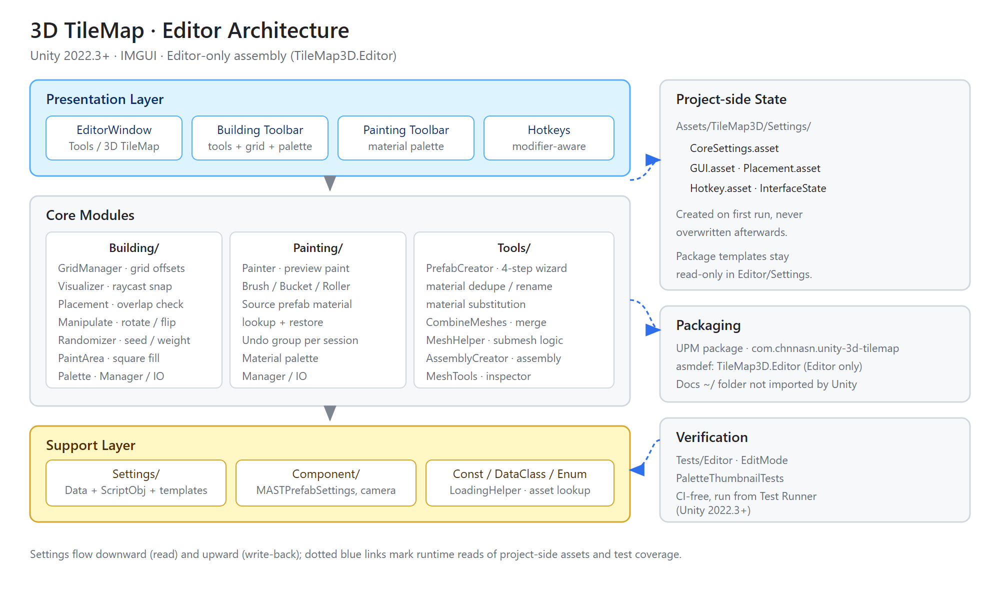
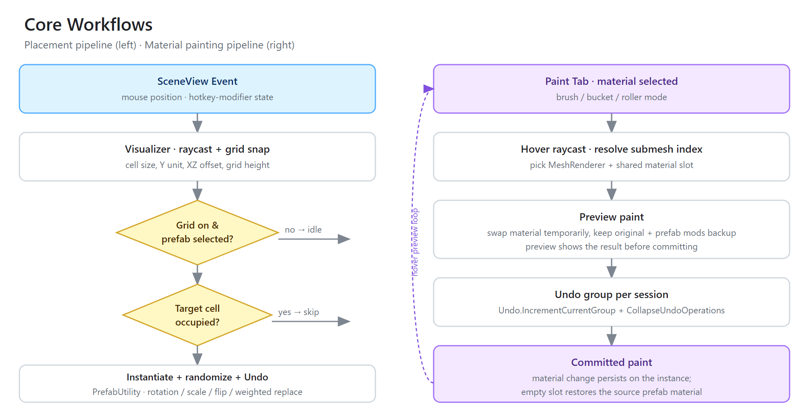

# 3D TileMap

> Unity 场景里的「模块化关卡搭建器」——把预制体当瓷砖铺，网格吸附、材质绘制、随机化摆放、批量合批，一套编辑器工具全包。
>
> **Unity 2022.3+ · 纯编辑器 · UPM 包 · MIT**



---

## 一句话介绍

面向 Unity 的 **3D 模块化关卡搭建工具**。设计师在场景中铺一层可视化网格，像刷贴图一样把预制体「刷」进关卡：单格点击、连续拖拽、方形区域填充，配合旋转 / 翻转 / 随机化 / 权重替换，让重复资产的摆放既可控又有变化感；已放置的模型还能直接换材质（笔刷 / 油漆桶 / 滚筒）。

## 作品集看点

| 维度 | 内容 |
|---|---|
| **产品完整度** | 从「原始模型」到「可摆放资产」到「成片关卡」的全链路：预制体批量生成 → 网格化摆放 → 材质绘制 → 合批导出 |
| **交互设计** | IMGUI 自绘工具栏 + 独立调色板，支持快捷键 + 修饰键组合（Shift 区分单次/连续操作），所有快捷键可在设置中重绑定 |
| **工程架构** | 三层分层（表现层 / 核心模块 / 支撑层），按功能域拆分为 `Building` / `Painting` / `Tools` 三个独立程序集内模块，`asmdef` 限定为编辑器程序集，运行时不进入构建 |
| **资产管线** | 缩略图在独立预览场景中离屏渲染并缓存到 `_MAST_Thumbnails/`，调色板秒开不卡顿 |
| **可移植性** | 设置数据从包内迁出到工程 `Assets/TileMap3D/Settings/`，包升级不覆盖用户配置；Git URL 安装与本地安装行为一致 |
| **质量保障** | 附 EditMode 测试，覆盖调色板缩略图生成链路 |

## 功能矩阵

### 搭建（Build）

- **可视化网格**：XZ 平面网格 + Y 方向分层（`Grid Up` / `Grid Down`），网格可整体 XZ 偏移对齐既有场景
- **灵活网格参数**：格子尺寸、Y 层高、网格覆盖范围、网格染色，四项均可独立配置
- **四种绘制模式**：单次点击（`Shift+D`）、连续拖拽（`Shift+C`）、方形区域填充（`Shift+P`）、擦除（`Shift+E`）
- **安全摆放**：基于 `Physics.OverlapBox` 的占位检测，同格不会重复堆叠；预制体可在 `MASTPrefabSettings` 上单独允许重叠
- **变换操作**：旋转（`Space`）、水平翻转（`F`）
- **随机化**：位置偏移 / 旋转范围与步进 / 缩放范围与轴锁（XZ、XYZ）/ 镜像翻转
- **加权替换**：同组预制体按权重随机替换，并可禁止连续重复，避免「一整片同款」

### 绘制（Paint）

- **三种笔刷**：笔刷（逐面涂）、油漆桶（连带整物体）、滚筒（沿表面连续涂）
- **悬停预览**：鼠标悬停即预览上色效果，移开即还原，不会误涂
- **原材质还原**：`Shift+R` 一键恢复来源预制体的原始材质
- **材质调色板**：从文件夹批量导入材质，缩略图可视化挑选

### 资产工具（Tools）

- **预制体生成器**：四步向导——查找模型 → 整理材质 → 链接材质 → 生成预制体
- **材质整理**：自动合并 Blender 导出的重名材质、重命名 / 批量替换材质
- **网格合批**：按材质名合并网格，支持排除指定子物体，显著降低 Draw Call
- **装配体生成**：把当前场景选中的 GameObject 组装成一个新的预制体（Assembly）

### 其他

- 预制体 / 材质缩略图缓存（128×128），首次生成后复用
- 窗口状态、选中的预制体、工具模式在重开窗口后自动恢复
- 全部摆放与绘制操作接入 Unity Undo，支持 `Ctrl+Z` 回退

## 架构



<details>
<summary><b>展开查看分层说明</b></summary>

- **表现层（Presentation）** — `Editor/Scripts/GUI`：主窗口 `EditorWindow`、工具栏、调色板、快捷键处理、播放模式状态监听。
- **核心模块（Core）**
  - `Building/` — 网格管理、射线可视化、摆放与占位检测、变换、随机化、区域填充、预制体调色板。
  - `Painting/` — 材质绘制器与三种笔刷、材质调色板。
  - `Tools/` — 预制体生成器、网格合批、装配体生成、网格辅助工具。
- **支撑层（Support）** — `Settings/`（设置数据结构 + 读写 + 模板）、`Component/`（`MASTPrefabSettings`、缩略图相机）、`Const` / `Enum` / `DataClass` / `LoadingHelper`（资源定位）。

</details>

## 安装

**方式一：本地路径**

1. 把本仓库克隆到 Unity 项目之外的任意目录；
2. 打开 `Window > Package Manager`，左上角 `+` → `Add package from disk...`；
3. 选择本目录下的 `package.json`，确认安装。

**方式二：Git URL**

`Window > Package Manager` → `+` → `Add package from git URL...`，填入：

```
https://github.com/chnnasn/unity_3D_TileMap.git
```

安装后菜单栏会出现 `Tools > 3D TileMap > Open Window`。

## 使用

1. 打开 `Tools > 3D TileMap > Open Window`；
2. 工具栏点 **Grid Toggle** 显示网格，用 `Grid Up` / `Grid Down` 切换高度层级；
3. 在 **Palette** 里选择瓦片（prefab），在场景中点击或拖拽绘制；
4. **Paint** 标签直接给已放置的模型换材质，支持笔刷 / 油漆桶 / 滚筒；
5. **Settings** 面板（工具栏齿轮）调整网格尺寸、偏移、快捷键与随机化参数。

### 默认快捷键

| 操作 | 快捷键 | 操作 | 快捷键 |
|---|---|---|---|
| 单次绘制 | `Shift+D` | 连续绘制 | `Shift+C` |
| 区域填充 | `Shift+P` | 擦除 | `Shift+E` |
| 网格开关 | `G` | 网格上升 / 下降 | `Shift+W` / `Shift+S` |
| 旋转 / 翻转 | `Space` / `F` | 取消选择 | `Esc` |
| 绘制材质 | `Shift+M` | 还原材质 | `Shift+R` |
| 随机化开关 / 重掷 | `Shift+X` / `X` | | |

所有快捷键均可在设置面板中重绑。

### 网格参数

| 参数 | 说明 |
|---|---|
| Cell Size X / Z | 单个格子在世界空间的边长 |
| Y Unit Size | 每升 / 降一层的世界高度 |
| Cell Count X / Z | 网格从中心到边缘的格数（总宽度 = 2 × Count × Cell Size） |
| Offset X / Y / Z | 网格整体平移，用于对齐既有场景 |

## 设置存放位置

工具的**设置不写在包里**，而是首次运行时自动创建到工程内：

```
Assets/TileMap3D/Settings/
├── CoreSettings.asset      # 路径配置
├── GUI.asset                # 网格 / 调色板 / 工具栏
├── Placement.asset          # 摆放、旋转、射线、随机化
├── Hotkey.asset             # 快捷键
└── InterfaceState.asset     # 界面状态
```

包内 `Editor/Settings/` 中的同名文件只是**模板**，用于首次运行时初始化工程设置。想改默认值改模板即可，已存在的工程不会被覆盖。

## 包结构

```
unity_3D_TileMap/
├── package.json                 # UPM 包清单
├── LICENSE / CHANGELOG.md
├── Documentation~/
│   ├── Upstream/                # 上游 MAST 说明文档（Unity 不会导入该目录）
│   └── Docs/                    # README 引用的架构图与流程图
├── Editor/
│   ├── Scripts/                 # 全部 C# 代码（TileMap3D.Editor.asmdef，仅编辑器）
│   │   ├── Building/            # 网格、摆放、随机化、可视化、涂区、调色板
│   │   ├── Painting/            # 材质绘制（笔刷 / 油漆桶 / 滚筒）
│   │   ├── Component/           # MASTPrefabSettings、缩略图相机
│   │   ├── Settings/            # 设置数据结构与读写
│   │   ├── Tools/               # 预制体生成、合批、装配体生成
│   │   └── GUI/                 # 工具窗口、快捷键、状态
│   ├── Etc/                     # GUISkin、网格 / 涂区材质、橡皮刀、预览相机
│   ├── Images/                  # 工具栏图标
│   └── Settings/                # 设置模板（GUI / Placement / Hotkey）
└── Tests/Editor/                # EditMode 测试
```

## 技术栈与环境要求

- Unity **2022.3** 及以上（`package.json` 的 `unity` 字段声明最低版本）
- 纯 C# / IMGUI，无第三方运行时依赖
- 仅编辑器功能，运行时不进入玩家构建
- 编辑器测试：`Window > General > Test Runner > EditMode` → 运行 `PaletteThumbnailTests`

## 演进记录

| 版本 | 内容 |
|---|---|
| 1.0.0 | 从 MAST 派生并整理为独立 UPM 包；设置数据迁出到工程目录；程序集限定为编辑器；资源 GUID 重建，包与工程副本互不冲突 |
| 1.0.1 | 修复 Git 安装时网格材质与窗口皮肤资源定位失败；重开窗口时先恢复调色板再恢复选中项 |
| 1.0.2 | 修复文件夹批量加载时缩略图空引用；缩略图改为在独立预览场景中离屏渲染 |
| 1.0.3 | 文件夹选择框在窗口布局完成后打开，避免 `EndLayoutGroup` 报错 |

完整变更见 [CHANGELOG.md](CHANGELOG.md)。

## 上游与致谢

本项目是 [MAST - Modular Asset Staging Tool](https://www.fertilesoilproductions.com/mast)（Fertile Soil Productions，MIT）的衍生与改造版。改造内容包括：网格偏移 / 分层、宽网格支持、调色板持久化、材质绘制模块、随机化模块、UPM 包化改造、缩略图离屏渲染管线等。

上游作者声明与许可见 `Documentation~/Upstream/`。感谢 Fertile Soil Productions 提供的免费工具与社区支持。

## 许可

MIT。上游 MAST 的版权声明保留在 [LICENSE](LICENSE) 中，改造部分版权归 chnnasn。
